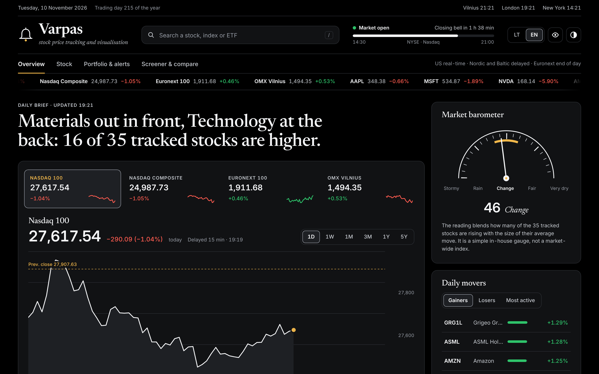

# Stocks viewer

A website for following US, European and Baltic stock prices, with a personal list that is kept only in the visitor's browser.



## Start

```bash
npm install
```

```bash
npm run dev
```

Open http://localhost:5173.

## Deploy

```bash
npx wrangler login
```

```bash
npm run deploy
```

Cloudflare rebuilds and deploys the site on every push to `main` (Workers Builds).

To rename the site, edit `src/config/brand.ts`.
